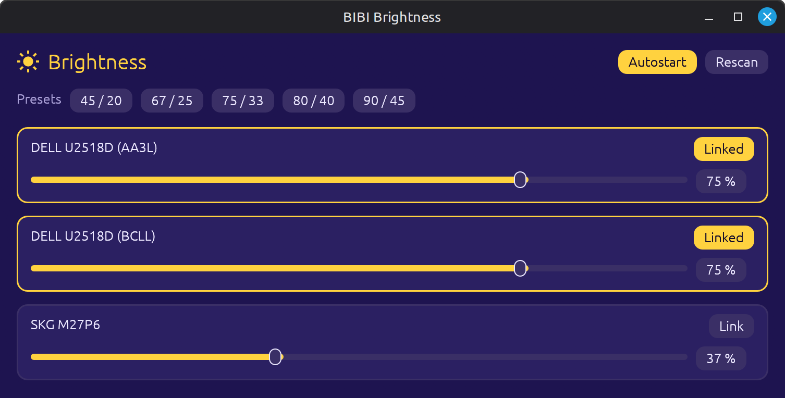
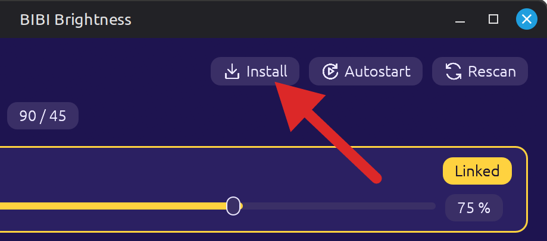

[//]: # (<p align="center"></p>)

# BIBI Brightness

Change brightness of your displays with a simple cross-platform UI in a single binary.

<p align="center">

</p>

## Download

Prebuilt binaries for Linux and Windows are attached to each
[release](https://github.com/matz0r/bibi-brightness/releases).

### Optional install
<p align="center">
    
</p>

## Windows

Unzip `bibi-brightness-<version>-windows-x86_64.zip` and start
`brightness.exe`. No installer or drivers needed. The binary is not signed, so
SmartScreen may warn on first start ("More info" → "Run anyway").

Click **Install** to keep it: it copies itself to
`%LOCALAPPDATA%\Programs\BIBI Brightness\`, adds it to the Start menu and
restarts from there. After that you can delete the download; Autostart points
to the installed copy. To update, choose **Quit** on the tray icon, start the
new download and click **Install** again.

## Linux

Needs glibc 2.35 (Ubuntu 22.04) or newer.

On first start, click **Set up access** and enter your password. This is
needed once per PC so the app can talk to the monitors.

<details>
<summary>Manual setup, if the button doesn't work</summary>

```bash
sudo usermod -aG i2c $USER                                   # access to /dev/i2c-*
echo i2c-dev | sudo tee /etc/modules-load.d/i2c-dev.conf     # load module at boot
sudo modprobe i2c-dev                                        # load it now
# then log out and back in
```

</details>

Unpack `bibi-brightness-<version>-linux-x86_64.tar.gz` and start `brightness`.
Click **Install** to copy it to `~/.local/bin/brightness` and add it to your
application menu. No administrator password is needed for installation.
The installed copy starts automatically and the previous tray and window close.
You can then delete the download.

On both platforms, **Install** appears when this binary is not installed,
when it is newer, or when it is a different build of the same version.
It stays hidden when the same build or a newer version is already installed.
Installation preserves enabled autostart and points it at the installed copy.

When upgrading from Linux v0.6.0, quit the old tray from its menu once before
installing: that version does not support the replacement command.

<details>
<summary>Manual installation</summary>

```bash
mkdir -p ~/.local/bin ~/.local/share/applications
cp brightness ~/.local/bin/
cp brightness.desktop ~/.local/share/applications/
mkdir -p ~/.local/share/icons/hicolor/256x256/apps
cp assets/icon.png ~/.local/share/icons/hicolor/256x256/apps/bibi-brightness.png
```

</details>

## Usage

- Each monitor has its own slider.
- Tick **Link** on two or more monitors and their sliders move together.
  A monitor joining the group takes the group's current brightness.
- Links are remembered per monitor model/serial.
- **Presets** (e.g. 60 / 25) set linked monitors to the first value and all
  other monitors to the second.
- Closing the window keeps Brightness running as an icon in the panel
  (Linux) or the notification area next to the clock (Windows). Click the
  icon to show or hide the sliders; right-click it for **Quit**.
- **Autostart** is selected only when the startup entry launches the current
  binary with `--tray`. It is checked when the window opens and refreshed while
  it is open. Click it to enable or disable startup for this copy.
- At login, Brightness waits for the desktop tray to become ready and reconnects
  if the panel restarts. If no tray appears within 15 seconds, it opens a window
  with a warning and a **Quit** button. While the tray is unavailable, closing a
  tray-managed window keeps it open so the app remains accessible.

## Development

Tray icon, building from source, changing presets and releasing: see
[DEVELOPMENT.md](https://github.com/matz0r/bibi-brightness/blob/main/DEVELOPMENT.md).

Third-party license notices are in `THIRD-PARTY-LICENSES.html`, included with
every release.
